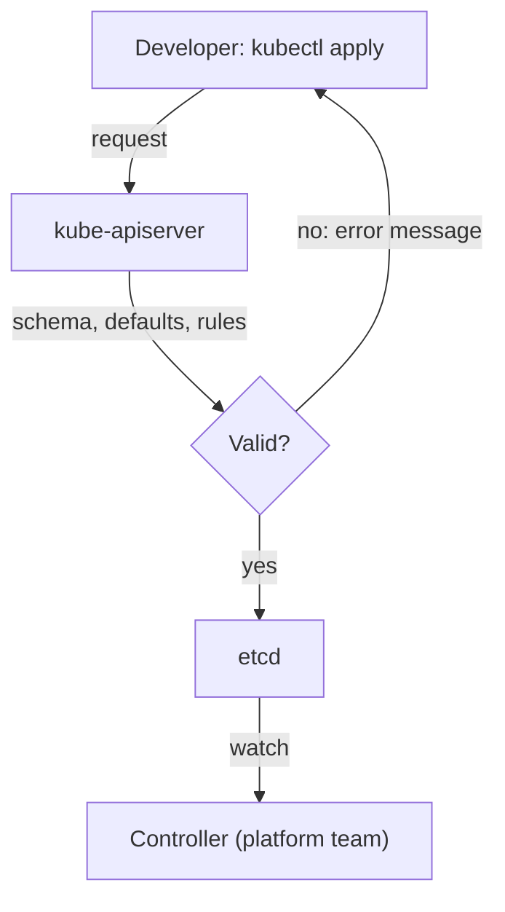

# A Request API With A CustomResourceDefinition

A developer needs a small test environment for a service. Today the developer opens a ticket, waits, and gets a reply that asks for a missing detail. Self-service replaces that conversation with a request that the platform can read, check and act on by itself. This part shows how to make such a request a real object in the Kubernetes API, so that the API server, and not a person, decides in milliseconds whether the request is valid.

## What a CustomResourceDefinition does

Kubernetes has built-in object kinds such as Pod and Deployment. A **CustomResourceDefinition** (CRD) adds a new kind to the API. After you apply a CRD, the API server serves a new endpoint for that kind, stores its objects in etcd, and lets `kubectl` create, list and delete them like any other object. A CRD does not run any code by itself. It only defines the shape of the data and the rules for it.

The CRD in this part defines the kind `EnvironmentRequest` in the API group `platform.starfleet.example`. A request says who owns the environment, which size class it needs, and how many hours it lives. The component that decides what a valid request is, is the API server. It checks every create and update against the OpenAPI schema inside the CRD before it stores the object.



The diagram shows that validation happens before storage. A controller, which the platform team writes, reacts only to requests that are already valid.

## Writing the schema

The schema is where the platform team decides what a user can choose. A good request type exposes the meaningful choices and hides the rest. The `class` field offers two supported values. The user does not pick CPU or memory directly. A field with an `enum` accepts only the listed values. A field with `default` gets a value when the user leaves it out, so the user states only what is different.

The CRD below also has a validation rule written in the Common Expression Language (CEL). CEL is a small expression language that the API server evaluates on every create and update. The rule `self.owner.endsWith('-team')` refers to the object under `spec`, and the `message` is the text the user sees when the rule fails. A rule with a readable message replaces a support question.

The block `subresources: status: {}` turns on a separate status endpoint. Users write `spec`, and a controller writes `status`. Keeping the two apart means that a user cannot mark their own request as `Ready`, and that RBAC can allow one without the other.

<!-- astrona:playground:renew -->
Save this as `environmentrequest-crd.yaml`:

```yaml
apiVersion: apiextensions.k8s.io/v1
kind: CustomResourceDefinition
metadata:
  name: environmentrequests.platform.starfleet.example
spec:
  group: platform.starfleet.example
  scope: Namespaced
  names:
    kind: EnvironmentRequest
    singular: environmentrequest
    plural: environmentrequests
    shortNames:
      - envreq
  versions:
    - name: v1alpha1
      served: true
      storage: true
      subresources:
        status: {}
      additionalPrinterColumns:
        - name: Class
          type: string
          jsonPath: .spec.class
        - name: Phase
          type: string
          jsonPath: .status.phase
      schema:
        openAPIV3Schema:
          type: object
          properties:
            spec:
              type: object
              required:
                - owner
              properties:
                owner:
                  type: string
                  description: Team that owns the environment. Must end with -team.
                class:
                  type: string
                  description: Size class. Supported values are small and medium.
                  enum:
                    - small
                    - medium
                  default: small
                ttlHours:
                  type: integer
                  description: Hours until the environment is removed, from 1 to 72.
                  minimum: 1
                  maximum: 72
                  default: 24
              x-kubernetes-validations:
                - rule: "self.owner.endsWith('-team')"
                  message: "owner must end with -team"
            status:
              type: object
              properties:
                phase:
                  type: string
                  enum:
                    - Pending
                    - Ready
                    - Failed
                conditions:
                  type: array
                  items:
                    type: object
                    required:
                      - type
                      - status
                    properties:
                      type:
                        type: string
                      status:
                        type: string
                        enum:
                          - "True"
                          - "False"
                          - Unknown
                      reason:
                        type: string
                      message:
                        type: string
```

Apply it:

```sh
kubectl apply -f environmentrequest-crd.yaml
```

Then check that the API server serves the new kind and reads the field descriptions from the schema:

```sh
kubectl api-resources --api-group=platform.starfleet.example
kubectl explain environmentrequest.spec
```

The first command lists `environmentrequests` with the short name `envreq`. The second prints the fields of `spec` with the descriptions written in the CRD. This is the first piece of documentation a user gets, and it comes from the same file that enforces the rules.

## Making a valid request

A user writes only what differs from the defaults. Save this as `envreq-scout-dev.yaml`:

```yaml
apiVersion: platform.starfleet.example/v1alpha1
kind: EnvironmentRequest
metadata:
  name: scout-dev
  namespace: team-alpha
spec:
  owner: alpha-team
```

Apply it:

```sh
kubectl apply -f envreq-scout-dev.yaml
```

Then read the stored object:

```sh
kubectl -n team-alpha get envreq scout-dev -o yaml
```

The stored object now has `class: small` and `ttlHours: 24`. The API server added both defaults while it admitted the request, so every consumer of the object, including a controller, sees complete data and never has to guess a missing value.

## Rejected requests

Rejection is the part of self-service that users meet most often, so its quality matters. Save this as `envreq-bad.yaml`:

```yaml
apiVersion: platform.starfleet.example/v1alpha1
kind: EnvironmentRequest
metadata:
  name: bad-request
  namespace: team-alpha
spec:
  owner: jason
  class: huge
  ttlHours: 500
```

Try to apply it:

```sh
kubectl apply -f envreq-bad.yaml
```

The API server refuses the request and prints an error for each field that failed: the unsupported `class`, the `ttlHours` above the maximum and the owner that does not end with `-team`. Nothing is stored. The user learns what to fix at once, and no operator was involved.

The same checks apply to every client. A web form, a command-line tool and a script that calls the REST API all reach the same API server, so a user cannot bypass a rule by calling the API directly. This is why a limit that exists only in a form is not a guardrail.

## What this part leaves open

The request exists, and it is valid, but nothing creates the environment yet. A controller must watch the objects and act. A schema also cannot check facts about the rest of the cluster, such as whether the team still has quota left. The next steps add those checks and the permissions around the request.

## Common pitfalls

> [!WARNING]
> A CRD alone only stores data. If no controller watches the objects, a request stays valid and unprocessed forever, and the user sees no result. Never describe a CRD as automation by itself. Also keep the schema strict: a field without a type, an enum or a limit accepts any value, and the invalid value only fails later inside the controller, far from the user who made the mistake.
