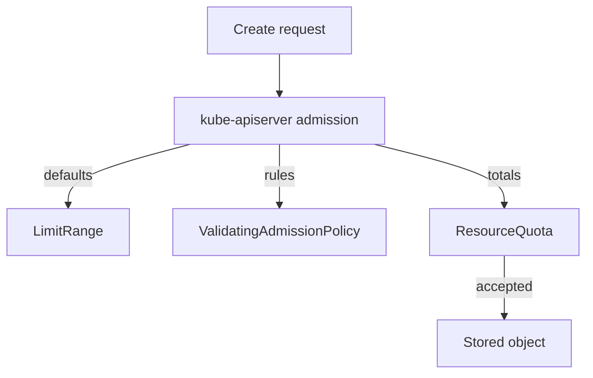

# Guardrails With Quota, Limits And Admission Policy

A request type with a schema stops invalid values. It does not stop a valid request that is unsafe for the cluster: a team that asks for fifty Pods, a container with no memory limit, or a Deployment that nobody owns. This part adds three server-side guardrails to the namespace of a team and shows what each one checks, which component enforces it, and what message the user sees.

## Three guardrails, three components

A **guardrail** is a rule that keeps a supported action inside safe limits while the user stays independent. It does not wait for an approval. It answers immediately, accepts the request or rejects it with a reason.

A **ResourceQuota** limits the total amount of resources, or the number of objects, in one namespace. The quota admission controller inside the API server adds up the usage and rejects a request that would go over the limit. A **LimitRange** sets default requests and limits for containers in a namespace, and minimum and maximum values for each container. The LimitRange admission controller fills in a missing limit on a new Pod, so a user who forgets the limit still gets a safe Pod. A **ValidatingAdmissionPolicy** (VAP) is a rule written in CEL that the API server evaluates on create and update. It can express rules that quota and limits cannot, such as "every Deployment needs an `owner` label".



The diagram shows that all three guardrails run inside the API server before the object is stored. None of them needs a person.

## Set a quota and default limits

Start with the namespace budget. The quota below allows at most six Pods and a total of two CPU cores of requests in `team-alpha`. The LimitRange gives every container a default memory request and limit, and refuses a container that asks for more than 512 Mi.

<!-- astrona:playground:renew -->
Save this as `team-alpha-limits.yaml`:

```yaml
apiVersion: v1
kind: ResourceQuota
metadata:
  name: team-quota
  namespace: team-alpha
spec:
  hard:
    pods: "6"
    requests.cpu: "2"
---
apiVersion: v1
kind: LimitRange
metadata:
  name: team-limits
  namespace: team-alpha
spec:
  limits:
    - type: Container
      defaultRequest:
        memory: 64Mi
      default:
        memory: 128Mi
      max:
        memory: 512Mi
```

Apply it:

```sh
kubectl apply -f team-alpha-limits.yaml
```

Then read how much of the quota is used:

```sh
kubectl -n team-alpha describe resourcequota team-quota
kubectl -n team-alpha describe limitrange team-limits
```

The first command lists each limited resource with its `Used` and `Hard` values. The second prints the defaults and the maximum. When a Pod is created in `team-alpha` without a memory limit, the LimitRange admission controller writes `128Mi` into the Pod before it is stored. A Pod that asks for `1Gi` is rejected, and the message names the maximum.

A quota has a side effect that surprises users. When a namespace has a quota for `requests.cpu`, every new Pod must state a CPU request, or the API server rejects it with a message that the quota needs the request to be set. A LimitRange `defaultRequest` for `cpu` removes that surprise. Quota and LimitRange work as a pair.

## Add a rule that quota cannot express

Quota counts, and the LimitRange sets sizes. Neither one can say that a Deployment must carry an owner label. A ValidatingAdmissionPolicy can. The policy has two objects. The policy defines the rule and what it matches. The **binding** says where the policy applies and what happens when it fails.

The `validations` list holds CEL expressions. If an expression returns `false`, the request fails. The `messageExpression` builds the message from the object, so the user sees the name of the Deployment that failed. The `validationActions` field of the binding chooses the effect: `Deny` rejects the request, `Warn` lets it through and sends a warning to the client, and `Audit` only records the failure in the audit log. A policy without a binding does nothing.

Save this as `vap-require-owner.yaml`:

```yaml
apiVersion: admissionregistration.k8s.io/v1
kind: ValidatingAdmissionPolicy
metadata:
  name: require-owner-label
spec:
  failurePolicy: Fail
  matchConstraints:
    resourceRules:
      - apiGroups: ["apps"]
        apiVersions: ["v1"]
        operations: ["CREATE", "UPDATE"]
        resources: ["deployments"]
  validations:
    - expression: "has(object.metadata.labels) && 'owner' in object.metadata.labels"
      messageExpression: "'Deployment ' + object.metadata.name + ' needs the label owner so the catalog can show who runs it'"
---
apiVersion: admissionregistration.k8s.io/v1
kind: ValidatingAdmissionPolicyBinding
metadata:
  name: require-owner-label-team-alpha
spec:
  policyName: require-owner-label
  validationActions:
    - Deny
  matchResources:
    namespaceSelector:
      matchLabels:
        kubernetes.io/metadata.name: team-alpha
```

Apply it:

```sh
kubectl apply -f vap-require-owner.yaml
```

Then test the rule with a server-side dry run, which sends the request through admission without storing anything. The first command creates a Deployment with no label:

```sh
kubectl -n team-alpha create deployment no-owner --image=ghcr.io/stefanprodan/podinfo:6.15.0 --dry-run=server
```

For the second test, save this as `deploy-with-owner.yaml`:

```yaml
apiVersion: apps/v1
kind: Deployment
metadata:
  name: with-owner
  namespace: team-alpha
  labels:
    owner: alpha-team
spec:
  replicas: 1
  selector:
    matchLabels:
      app: with-owner
  template:
    metadata:
      labels:
        app: with-owner
    spec:
      containers:
        - name: with-owner
          image: ghcr.io/stefanprodan/podinfo:6.15.0
```

Send it through admission without storing it:

```sh
kubectl apply --dry-run=server -f deploy-with-owner.yaml
```

The policy needs a few seconds to become active after you apply it. If the first test is accepted, wait and run it again. When the policy is active, the first test fails with the message from `messageExpression`. The second test passes because the label is present.

## The failure policy and the binding scope

Two settings decide how strict a policy is. `failurePolicy: Fail` rejects a request when the policy cannot be evaluated, for example when an expression raises an error. `failurePolicy: Ignore` lets the request through in that case. A guardrail that you want to rely on uses `Fail`. The binding scope decides which namespaces are protected. Here the binding selects only `team-alpha`, so the policy changes nothing in `starfleet` or `outpost`.

Changing `Deny` to `Warn` is a safe way to introduce a new rule. Users see the warning in their terminal, the platform team sees how often it fires, and nothing breaks. After the team has fixed its manifests, the binding changes to `Deny`.

## Messages are part of the product

A rejection that says only "denied" makes the user ask someone. A rejection that names the rule, the object and the fix lets the user repair the request alone. This is the difference between a guardrail and a hidden approval. Write the message for a developer who has never read the policy. Say which field to change and, when possible, which value is supported.

## Common pitfalls

> [!WARNING]
> A ValidatingAdmissionPolicy does nothing until a binding selects it, and a binding with `Warn` or `Audit` never rejects. A quota with `requests.cpu` rejects Pods that have no CPU request unless a LimitRange sets a default. Existing objects are not changed when a policy is added: admission only checks new creates and updates, so a Deployment without an owner label that already runs stays as it is.
