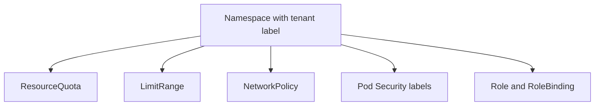

# The Namespace As A Tenant Boundary

A new team asks the platform team for a place to run its services. The platform team creates a namespace, but an empty namespace gives the team no protection and gives the cluster no protection from the team. This part explains what a namespace does, so that you know which controls you still have to add.

## What a namespace scopes

A **namespace** is a named scope inside one Kubernetes cluster. Most object kinds, such as Pods, Services, Deployments, ConfigMaps and Roles, live inside exactly one namespace, and two namespaces can hold objects with the same name. Some kinds are cluster-scoped and have no namespace: Nodes, Namespaces, CustomResourceDefinitions and ClusterRoles.

A namespace gives you a place to attach policy. A ResourceQuota, a LimitRange, a Role, a NetworkPolicy and a Pod Security label all apply to the objects of one namespace. That makes the namespace the natural unit for a tenant: one team, one namespace, one set of controls.

## What a namespace does not do

By default a namespace does not isolate anything. Pods in different namespaces share the same nodes, and they can reach each other over the network when they know the Service name, for example `scout.starfleet.svc`. The scheduler places Pods of any namespace on any node. One namespace can use all the CPU and memory of the cluster unless a quota stops it.

You can see the default behaviour on the playground. The workload `drifter` in the namespace `outpost` is a client outside the `starfleet` namespace. Run this command to list the Pods of the namespace `starfleet` from your terminal:

<!-- astrona:playground:renew -->
```sh
kubectl get pods -n starfleet
```

The Pods `scout`, `probe` and `shuttle` are listed. Nothing in the cluster stops a Pod in `outpost` from sending a request to the Service `scout` in `starfleet`, because no NetworkPolicy exists in either namespace.

## Labels carry the tenant identity

A platform needs to know which namespaces are tenants and who owns them. The usual solution is a label on the namespace. Labels are key and value pairs that the platform team chooses, and tools select objects by them. This module uses the key `platform.starfleet.example/tenant`.

Create the tenant namespace with its label. Save this as `namespace-team-gamma.yaml`:

```yaml
apiVersion: v1
kind: Namespace
metadata:
  name: team-gamma
  labels:
    platform.starfleet.example/tenant: gamma
```

Apply it:

```sh
kubectl apply -f namespace-team-gamma.yaml
```

Then list all tenants with a label selector:

```sh
kubectl get namespaces -l platform.starfleet.example/tenant
```

The output lists `team-gamma`. A reporting tool, a policy or a controller can use the same selector to find every tenant.



The diagram shows the controls that attach to one namespace. The next parts add each of them.

A namespace is a boundary for policy and naming, not a security wall. The rest of this module adds the controls that make the boundary real.

## Common pitfalls

> [!WARNING]
> - Do not assume that two namespaces cannot talk to each other. Without a NetworkPolicy they can.
> - Do not put tenant data in cluster-scoped objects. Only the namespace controls can protect namespaced objects.
> - A label on the namespace does nothing by itself. A policy or a tool must read it.
