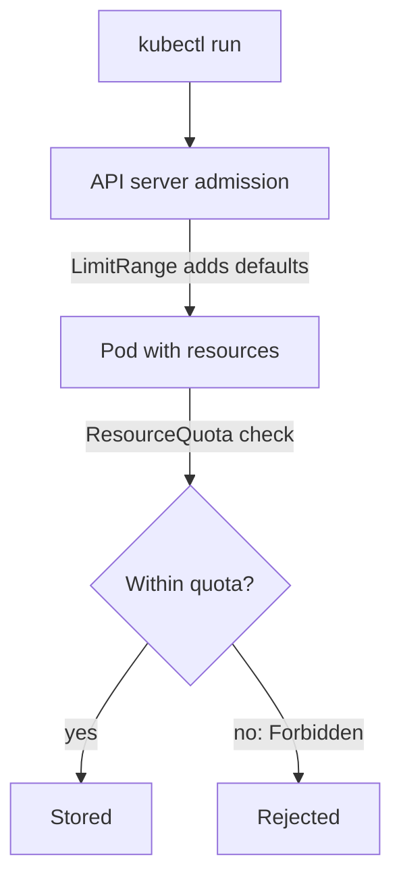

# Quota And Default Limits Per Tenant

Giving a team a namespace without limits lets one mistake, such as a Deployment with a hundred replicas, use all the capacity of the cluster. A platform that offers self-service must set the limits first. This part adds the two objects that do this: the ResourceQuota and the LimitRange.

## ResourceQuota limits the total

A **ResourceQuota** limits the total amount of resources that all objects in one namespace may use. It can limit compute, such as `requests.cpu` and `limits.memory`, and it can limit the number of objects, such as `pods` or `services`. The API server checks the quota when it admits a new object. If the object would push the total over the limit, the API server rejects the request with a `Forbidden` error that names the quota.

Save this as `resourcequota-tenant.yaml`:

<!-- astrona:playground:renew -->
```yaml
apiVersion: v1
kind: ResourceQuota
metadata:
  name: tenant-quota
  namespace: team-gamma
spec:
  hard:
    pods: "10"
    requests.cpu: "2"
    requests.memory: 4Gi
    limits.memory: 8Gi
```

Apply it and read the usage:

```sh
kubectl apply -f resourcequota-tenant.yaml
kubectl describe resourcequota tenant-quota -n team-gamma
```

The `describe` command lists each resource with its `Used` and `Hard` values. The used values are zero because the namespace has no Pods.

## A quota makes requests mandatory

A quota on `requests.cpu` has a side effect. When a namespace has a quota for a compute resource, every new Pod must state a value for that resource, otherwise the API server rejects the Pod. A developer who forgets the `resources` block then sees a rejection and does not know why. The second object solves this.

## LimitRange sets defaults and bounds

A **LimitRange** sets default requests and limits for containers in a namespace, and it can set minimum and maximum values. When a container has no request or limit, the API server adds the default while it admits the Pod. When a container asks for more than the maximum, the API server rejects it.

Save this as `limitrange-tenant.yaml`:

```yaml
apiVersion: v1
kind: LimitRange
metadata:
  name: tenant-defaults
  namespace: team-gamma
spec:
  limits:
    - type: Container
      defaultRequest:
        cpu: 100m
        memory: 128Mi
      default:
        cpu: 500m
        memory: 256Mi
      max:
        memory: 1Gi
```

Apply it:

```sh
kubectl apply -f limitrange-tenant.yaml
```

Now start a Pod without any `resources` block and read what the API server added:

```sh
kubectl run probe-test -n team-gamma --image=ghcr.io/stefanprodan/podinfo:6.15.0
kubectl get pod probe-test -n team-gamma -o jsonpath='{.spec.containers[0].resources}'
```

The second command prints the default request and limit from the LimitRange. The Pod was admitted although it had no `resources` block, because the LimitRange filled it in before the quota check.



The diagram shows the order. Defaults come first, so the quota can count the values.

Remove the test Pod when you are done:

```sh
kubectl delete pod probe-test -n team-gamma
```

You now have a namespace that cannot grow without a limit and that accepts Pods without resource settings. The next question is who can talk to whom, and what a Pod may do.

## Common pitfalls

> [!WARNING]
> - A ResourceQuota for `requests.cpu` rejects Pods without a CPU request unless a LimitRange sets a default.
> - A quota counts objects that exist now. Deleting a Pod frees its share at once.
> - A LimitRange default applies only to new Pods. Running Pods keep their old values.
