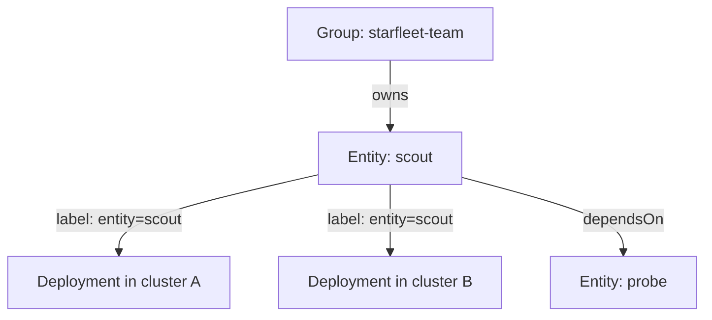

# The Catalog Model: Entities, Owners And Relationships

An alert fires at night for a Deployment called `probe`. The on-call engineer needs to know who owns it, what depends on it and where its documentation is. Kubernetes can show that the Deployment exists, but it does not say which team is responsible. A service catalog answers these questions. This part explains what the catalog stores, how an entity differs from the things that run it, and why relationships and ownership are the parts that make it useful.

## Entities

An **entity** is one item that the catalog describes. Every entity has a kind, a name, an owner and a lifecycle. The kinds that most catalogs use come from the Backstage software catalog model, which is the best-known open-source example of this idea.

- **Component**: a piece of software that someone builds and runs, such as a service, a website or a library. In this course, `scout`, `probe` and `shuttle` are components.
- **API**: an interface that a component offers to others, such as an HTTP API with a published specification.
- **Resource**: infrastructure that a component needs but that is not software the team builds, such as a database or a message queue.
- **System**: a group of components, APIs and resources that together deliver one function to users.
- **Group and User**: the organizational entities that own other entities.

The **lifecycle** says what the owner promises. A common set is `experimental` (may change or disappear), `production` (supported and relied on) and `deprecated` (still running, planned for removal). A consumer reads the lifecycle before it depends on a component.

## Entity identity and deployment identity

The most important modelling decision is that an entity is not a running workload. The entity `scout` is a stable identity: it stays the same when the code moves to a new repository, when it runs in three clusters, and when a new version rolls out. A **deployment** is one running instance of it: a Deployment object in one namespace of one cluster.

The relationship is one entity to many deployments. If the catalog used the name of a Kubernetes object as the identity, the entity would split into several records when the service is deployed to a second cluster, and the history of ownership and documentation would be lost. The link between the two is a label or annotation on the workload. Backstage uses the annotation `backstage.io/kubernetes-id` for this, and the catalog in this module uses a label that carries the entity name.



The diagram shows that ownership and dependencies belong to the entity, and that each running instance points back to the entity by a label.

## Ownership

An **owner** is the team that answers for the entity. The owner is an entity itself, a Group, not a person's name. People change jobs, and a group stays. An entry owned by a person who left the company has no owner in practice.

Ownership answers four daily questions: who gets the alert, who reviews a change, who decides to retire the component, and who answers a question about the API. A catalog with many entities and no owners is a list of names. Because ownership matters this much, a good catalog treats a missing owner as an error that the API rejects, and not as an optional field.

## Relationships

A **relationship** is a link between two entities. The three used most are `dependsOn` (this component needs that one to work), `providesApis` and `consumesApis` (which interface it offers and which it uses), and `partOf` (which system it belongs to). Relationships make two kinds of question possible. "What breaks if `probe` is down?" follows the dependencies backwards. "What does `shuttle` need to start?" follows them forwards.

A relationship is a reference by name. That makes it fragile in one way: if the target entity does not exist, the reference points at nothing. This is a **dangling reference**. The catalog must be able to detect it, because a wrong dependency graph looks complete and misleads the person who reads it during an incident.

## From a descriptor file to an API object

Backstage reads entity descriptions from files named `catalog-info.yaml` that live in each repository. The file is below as an example of the format. You do not apply it in this cluster.

```yaml
apiVersion: backstage.io/v1alpha1
kind: Component
metadata:
  name: scout
  description: Backend service that answers fleet queries
  annotations:
    backstage.io/kubernetes-id: scout
spec:
  type: service
  lifecycle: production
  owner: group:default/starfleet-team
  system: starfleet-system
  dependsOn:
    - component:default/probe
```

The descriptor keeps the data next to the code, so the team that changes the service also updates the entry. A catalog service ingests these files and stores the entities. In an **API-driven** catalog, other tools go further: they read and write entities through an API. The next part stores the same information as objects of a custom kind in the Kubernetes API.

## Looking at what runs

A catalog starts from what exists. List the workloads and their labels in the playground:

<!-- astrona:playground:renew -->
```sh
kubectl get deployments -A --show-labels
kubectl get services -A
```

The first command lists the Deployments of `starfleet` and `outpost` with their labels. Each has only the label `app`. Nothing in the objects says who owns them, which system they belong to or what they depend on. That information does not exist in Kubernetes, so the catalog must store it, and someone must keep it correct.

Find one fact in the cluster that the catalog could use: the image of each Deployment.

```sh
kubectl get deployments -A -o custom-columns=NS:.metadata.namespace,NAME:.metadata.name,IMAGE:.spec.template.spec.containers[0].image
```

The image names a version, but a catalog entity is about the service, not the version. The entity stays `scout` when the image changes from one version to the next.

## What a catalog is not

A catalog is not a monitoring system and not a copy of the cluster. Monitoring reports the current state of each instance. A catalog records stable facts and human decisions: ownership, lifecycle, dependencies, documentation. A catalog that tries to copy every runtime field falls behind and loses trust. Keep the stored fields small and let other systems supply the live state through the link from the entity to its workloads.

## Common pitfalls

> [!WARNING]
> Do not use the name of a Kubernetes object as the identity of an entity, because one service often runs in several namespaces and clusters. Do not make `owner` optional, and do not name a person as the owner. Also remember that a relationship written by name is only a claim: a reference to an entity that does not exist is a dangling reference, and the catalog still shows it unless something checks it.
