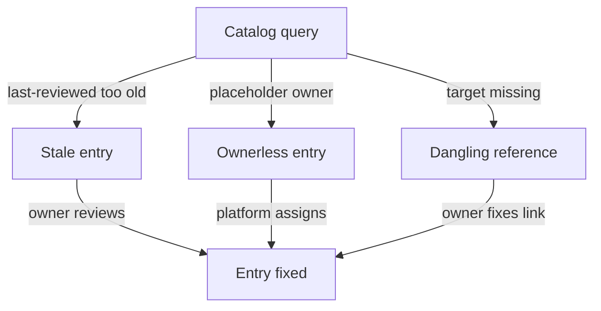

# Keeping The Catalog Useful

A catalog is trusted on the day it is filled and distrusted a few months later. Teams reorganize, services are retired, dependencies change, and nobody updates the entries. When an engineer finds one wrong answer, the engineer stops using the catalog for every question. This part defines the three faults that destroy trust, shows how to find each one with a query, and explains who must repair it.

The commands below need the `CatalogEntity` kind in the cluster, the namespace `catalog` with the entities `scout`, `probe` and `shuttle`, and the Starfleet Deployments in `starfleet` and `outpost`.

## Three faults

A **stale entry** is an entry that nobody has confirmed for a long time. Its content may still be true, but there is no evidence. The catalog records the date of the last review in an annotation, and a rule such as "reviewed in the last 90 days" turns freshness into something a query can check.

An **ownerless entry** is an entry whose owner is missing, a group that no longer exists, or a placeholder. The schema can force the field to be present, but it cannot know that `group:unassigned` is a placeholder. A query that looks for known placeholder values finds these entries, and a check against the list of real groups finds the rest.

A **dangling reference** is a relationship to an entity that does not exist. It appears when someone deletes an entity that others still depend on, or mistypes a name. The reference looks like a normal dependency, so a reader trusts a graph that has holes.



The diagram shows that each fault has its own query and its own person who repairs it. The query is automated, and the repair needs a decision.

## Adding entries with faults

To practise the queries, add two entries that carry faults. The entry `drifter` depends on a component that is not registered. The entry `old-beacon` has the placeholder owner and a review date from March 2025. Save this as `entities-gaps.yaml`:

<!-- astrona:playground:renew -->
```yaml
apiVersion: catalog.starfleet.example/v1alpha1
kind: CatalogEntity
metadata:
  name: drifter
  namespace: catalog
  annotations:
    catalog.starfleet.example/last-reviewed: "2026-10-22"
spec:
  kind: Component
  lifecycle: experimental
  owner: group:outpost-team
  description: Client that runs in the outpost namespace
  dependsOn:
    - component:telemetry-relay
---
apiVersion: catalog.starfleet.example/v1alpha1
kind: CatalogEntity
metadata:
  name: old-beacon
  namespace: catalog
  annotations:
    catalog.starfleet.example/last-reviewed: "2025-03-01"
spec:
  kind: Component
  lifecycle: deprecated
  owner: group:unassigned
  description: Retired signalling service
```

Apply it:

```sh
kubectl apply -f entities-gaps.yaml
```

## Query each fault

Stale entries come first. Dates in the form `YYYY-MM-DD` sort the same way as text, so a text comparison with a cutoff date works. An entry without the annotation counts as stale because the empty text sorts before any date:

```sh
kubectl -n catalog get ent -o json | jq -r --arg cutoff "2026-08-01" '.items[] | select((.metadata.annotations["catalog.starfleet.example/last-reviewed"] // "") < $cutoff) | .metadata.name'
```

The command prints `old-beacon`. The three starting entries and `drifter` were reviewed after the cutoff, so they do not appear.

Ownerless entries use the placeholder value:

```sh
kubectl -n catalog get ent -o json | jq -r '.items[] | select(.spec.owner == "group:unassigned") | .metadata.name'
```

Dangling references need two steps in one filter. The filter first builds the list of valid references from the entities (the kind in lower case, a colon, the name). It then keeps every `dependsOn` entry that is not in that list:

```sh
kubectl -n catalog get ent -o json | jq -r '[.items[] | ((.spec.kind | ascii_downcase) + ":" + .metadata.name)] as $ids | .items[] | .metadata.name as $n | .spec.dependsOn[]? | select(. as $d | $ids | any(. == $d) | not) | $n + " -> " + .'
```

The command prints `drifter -> component:telemetry-relay`. The entity `drifter` exists, but the thing it depends on does not. Someone must either register `telemetry-relay` or remove the dependency.

## Catalog and cluster drift

The catalog and the cluster change independently, so they drift apart. Two checks find it. The first finds running Deployments that no entity claims, because they have no entity label:

```sh
kubectl get deployments -A -o json | jq -r '.items[] | select(.metadata.labels["catalog.starfleet.example/entity"] == null) | .metadata.namespace + "/" + .metadata.name'
```

At this point every Deployment is unlabeled, so the command lists `starfleet/scout`, `starfleet/probe`, `starfleet/shuttle` and `outpost/drifter`. The second check finds labels that point at no entity, which is what a typing error produces. Save the entity names, then compare:

```sh
kubectl -n catalog get ent -o json | jq '[.items[].metadata.name]' > entity-names.json
kubectl get deployments -A -o json | jq -r --slurpfile names entity-names.json '.items[] | .metadata.labels["catalog.starfleet.example/entity"] as $e | select($e != null and ($names[0] | any(. == $e) | not)) | .metadata.name'
```

The second command prints nothing now, because no label exists yet. After you add a label with a typo, it prints that Deployment.

## Who repairs what

The platform team owns the tools: the schema, the queries and the report that lists faults. The owning team owns the content. A stale entry is repaired by the owner, who reads the entry, corrects it and updates the review date. An ownerless entry is repaired by the platform team together with the organization, because someone must decide which group takes it. A dangling reference is repaired by the team that wrote the dependency: it registers the missing entity or removes the link.

Review the entry after the repair, not before. Setting the date without reading the entry hides the fault from the query and keeps the fault. For a retired service, the right repair is to delete the entity and handle the dependents, not to keep a deprecated entry forever.

```sh
kubectl -n catalog annotate ent old-beacon catalog.starfleet.example/last-reviewed=2026-11-02 --overwrite
```

After this command, the stale query no longer lists `old-beacon`. The entry is still deprecated and ownerless, so the second query still finds it. Each query tests one fault.

## Make the check routine

A query that nobody runs does not protect the catalog. The usual practice is to run the same queries on a schedule, publish the counts, and send the list of faults to the owners. The count of faults over time is also a measure of catalog health: a rising count of stale entries means that owners do not review, and a rising count of dangling references means that deletions are not coordinated. Treat a fault that stays open as feedback about the process, not only about one entry.

## Common pitfalls

> [!WARNING]
> Updating the review date without reading the entry makes the freshness check pass and the entry wrong. A catalog that is only filled once decays, so give each entity an owner who reviews it on a schedule. Do not delete an entity before you check which other entities depend on it, because the delete creates dangling references in every dependent.
