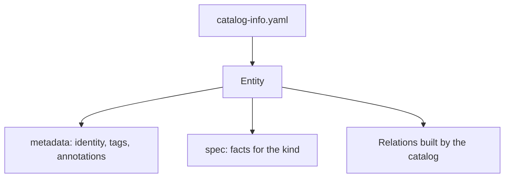

# The Anatomy Of A Descriptor

A catalog needs a standard way for teams to describe their software. A free-form wiki page is hard to read by a program, and a database form is hard to keep next to the code. The descriptor format solves both problems: it is a YAML file in the repository of the service, reviewed like code, and a catalog tool reads it. This part explains the four top-level parts of every descriptor.

## One file, one or more entities

A descriptor file holds one entity, or several entities separated by `---`. Every entity has the same envelope. The field `apiVersion` names the descriptor format version. In Backstage it is `backstage.io/v1alpha1` for most kinds. The field `kind` names the type of entity, for example `Component`. The field `metadata` holds the identity and the labels of the entity. The field `spec` holds the facts that depend on the kind.

You can read the descriptors of the playground. They are stored in a ConfigMap, one file per key. List the keys first:

<!-- astrona:playground:renew -->
```sh
kubectl get configmap entity-files -n catalog-files -o jsonpath='{.data}' | jq 'keys'
```

The output lists `probe.yaml` and `scout.yaml`. Print the descriptor of the `scout`:

```sh
kubectl get configmap entity-files -n catalog-files -o jsonpath='{.data.scout\.yaml}'
```

The backslash before the dot tells `jsonpath` that the key is `scout.yaml` and not a path.

## The metadata fields

The `metadata` block identifies the entity. The field `name` is required. It must be unique inside its kind and namespace, and it may contain letters, digits, `-`, `_` and `.`. The field `namespace` is optional and defaults to `default`. The field `title` is a human-readable name, `description` is a short sentence, and `tags` is a list of short labels for search.

Two more fields carry machine-readable data. The map `labels` holds key and value pairs that tools use to select entities. The map `annotations` holds key and value pairs that connect the entity to other systems, such as a source repository or a documentation folder. The list `links` holds URLs with a title and an icon for the portal page of the entity.

A minimal descriptor for the `scout` service looks like this:

```yaml
apiVersion: backstage.io/v1alpha1
kind: Component
metadata:
  name: scout
  description: Backend service that answers scan requests
  tags:
    - backend
spec:
  type: service
  lifecycle: production
  owner: group:default/scout-team
  system: navigation
```

The identity of the entity is the triple of kind, namespace and name. This entity is `component:default/scout`. The identity does not depend on where the service runs. A Deployment named `scout` in another cluster is a different thing from the entity.



The diagram shows that the file holds identity and facts, and the catalog builds the relations from them.

## Common pitfalls

> [!WARNING]
> - A tab character in a YAML file is a syntax error. Use spaces.
> - Two entities of the same kind with the same namespace and name conflict. The catalog keeps one and reports the other.
> - Do not put secrets in a descriptor. The file is in the repository and the catalog shows it.
