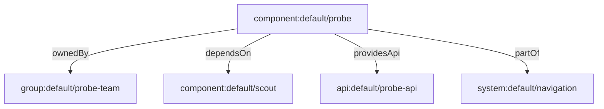

# Entity References And Relations

A descriptor names other entities in several fields. Those names must be exact, or the catalog cannot connect the entities. This part explains the reference syntax and the relations that the catalog builds from the fields.

## The entity reference

An **entity reference** is a string that identifies one entity. The full form is `kind:namespace/name`, for example `component:default/scout`. Each field of a descriptor that expects a reference has a default kind, and you can leave out parts that match the default. In `spec.owner` the default kind is `Group` and the default namespace is `default`, so `scout-team` means `group:default/scout-team`. In `spec.dependsOn` the default kind is `Component`.

Write the full form when you want a reader to see the kind at once. The full form is also safe when a name could mean two kinds.

## Relations are derived

A **relation** is a directed link between two entities, such as `ownedBy`. You never write a relation in a descriptor. The catalog derives it from the fields, and it always creates the reverse relation as well, so that you can navigate in both directions.

| You write | The catalog creates |
| --- | --- |
| `spec.owner` on a Component | `ownedBy` on the Component and `ownerOf` on the Group |
| `spec.dependsOn` | `dependsOn` and `dependencyOf` |
| `spec.providesApis` | `apiProvidedBy` on the API and `providesApi` on the Component |
| `spec.consumesApis` | `apiConsumedBy` and `consumesApi` |
| `spec.system` | `partOf` and `hasPart` |



The diagram shows the relations that a single Component creates. One file with four fields makes four links.

## A dangling reference

A reference to an entity that does not exist is a **dangling reference**. The catalog still stores the relation, but the target has no page, and a portal shows an error or an empty link. Typical causes are a typo, a renamed entity and a deleted repository. A catalog health check should list dangling references, because they hide the real dependencies of a service.

You can test a reference by checking that the target descriptor exists. In the playground the descriptors are keys of the ConfigMap, so this command lists the entity names that are defined:

<!-- astrona:playground:renew -->
```sh
kubectl get configmap entity-files -n catalog-files -o jsonpath='{.data}' | jq -r 'keys[]'
```

If a `dependsOn` reference names a component that has no key in the list, the reference dangles.

## Common pitfalls

> [!WARNING]
> - Do not write the reverse relation by hand. The catalog creates it.
> - A name is case-sensitive in a reference, and a name with a different case is a different entity or a dangling reference.
> - When you rename an entity, every reference to it must change in the same pull request.
