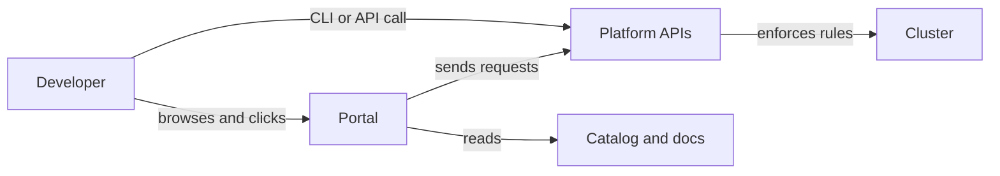

# The Portal And The Platform

People often say "the portal" when they mean "the platform". The two are different things, and mixing them up leads to portals that promise more than the platform does, or platforms that nobody can use without a portal. This part separates them, lists what a portal does, and runs a small portal in the playground so that you see where its data comes from and how it goes wrong.

## Two layers

The **platform** is the set of capabilities that the platform team operates: APIs that create environments, controllers that reconcile requests, policies that enforce rules, and a catalog that records what exists. A developer can use all of them with a command line tool, a Git repository or a plain HTTP call.

The **portal** is a user interface on top of the platform. It does not run workloads and it does not enforce rules. It reads from the catalog and the documentation, shows the result in one place, and sends requests to platform APIs when a developer clicks an action. If the portal is down, the platform still runs and the platform APIs still answer.



The diagram shows two ways to the same platform. Both paths reach the same APIs, so the same rules apply to a click and to a script. When a rule lives only in the portal, a developer who uses the API skips it, and the platform has no guardrail.

## What a portal does

A portal normally has three functions. **Discovery** lets a developer find a service, its owner, its lifecycle and its documentation without asking in chat. **Documentation** gathers the guides that explain how to use the platform. **Tasks** offer actions such as "create a new service" or "request an environment" through forms and templates.

Each function depends on data from somewhere else. Discovery depends on the catalog. Documentation depends on files that teams keep current. Tasks depend on templates and APIs. The portal adds convenience, and it also adds a copy of the data. Every copy can become out of date, so the first question about any portal is where its data comes from and how often that data is refreshed.

## A small portal in the playground

A static portal is enough to show the mechanism. The portal below is an nginx web server that serves one file, `services.json`, from a ConfigMap. The file is the portal's copy of the service list. It has a field `updated` with the date of the last refresh, so a reader can see how old the copy is.

Save this as `portal.yaml`:

<!-- astrona:playground:renew -->
```yaml
apiVersion: v1
kind: ConfigMap
metadata:
  name: portal-catalog
  namespace: portal
data:
  services.json: |
    {
      "updated": "2026-09-01",
      "services": [
        {"name": "scout", "owner": "starfleet-team", "lifecycle": "production", "docs": "docs/scout"},
        {"name": "probe", "owner": "starfleet-team", "lifecycle": "production", "docs": "docs/probe"}
      ]
    }
---
apiVersion: apps/v1
kind: Deployment
metadata:
  name: portal
  namespace: portal
  labels:
    app: portal
spec:
  replicas: 1
  selector:
    matchLabels:
      app: portal
  template:
    metadata:
      labels:
        app: portal
    spec:
      containers:
        - name: nginx
          image: nginx:1.27-alpine
          ports:
            - containerPort: 80
          readinessProbe:
            httpGet:
              path: /services.json
              port: 80
          volumeMounts:
            - name: catalog
              mountPath: /usr/share/nginx/html
      volumes:
        - name: catalog
          configMap:
            name: portal-catalog
---
apiVersion: v1
kind: Service
metadata:
  name: portal
  namespace: portal
spec:
  selector:
    app: portal
  ports:
    - port: 80
      targetPort: 80
```

Apply it and wait until the portal is ready:

```sh
kubectl apply -f portal.yaml
kubectl -n portal rollout status deployment/portal --timeout=120s
```

## Reading the portal as a developer

A developer reaches the portal through its Service. In the playground the client Pod `drifter` in the namespace `outpost` plays the developer. It has `curl`, and it reaches the portal by the name `portal.portal.svc.cluster.local`. The first `portal` is the Service and the second is the namespace.

```sh
kubectl -n outpost exec deploy/drifter -- curl -s http://portal.portal.svc.cluster.local/services.json
```

The command prints the JSON from the ConfigMap, with two services and the date `2026-09-01`. The cluster runs four Starfleet workloads, so the portal already lacks two of them. A developer who looks for `shuttle` or `drifter` finds nothing and concludes that the portal is incomplete.

## Where the data goes wrong

The mounted ConfigMap is the portal's only source. Nobody refreshes it unless somebody does it. This is the normal failure of a portal: it starts correct and drifts, because the copy has no connection to the source.

A refresh is an update of the ConfigMap. Kubernetes copies the new content into the running Pod without a restart, but not at once. The kubelet syncs mounted ConfigMaps periodically, so a change can take up to about a minute to appear. A reader who updates the ConfigMap and immediately fetches the old content has not found a bug. Wait and read again.

```sh
kubectl -n portal get configmap portal-catalog -o jsonpath='{.data.services\.json}' | jq '.services | length'
```

This command reads the source of the portal's data and counts the services. It prints `2`. Compare it with the number of Deployments that run in the cluster, and you have the first measure of portal quality: the share of running services that the portal shows.

## What the portal should not do

Three design rules keep a portal honest. First, the portal reads data from the system of record, for example the catalog, and does not become a second record that people edit by hand. A hand-edited copy is the source of the failure above. Second, the portal sends requests to platform APIs and never holds rules of its own, so a script and a click face the same checks. Third, every function of the portal has an alternative path, such as a command line tool, an API or a Git repository, so an engineer who cannot use the portal is not blocked.

The third rule also matters for incidents. When the portal is unavailable during an outage, the people who must fix the problem need another way to reach the platform. A platform that can only be used through the portal has a single point of failure in its user interface.

## Common pitfalls

> [!WARNING]
> A portal with a hand-edited copy of the catalog goes out of date, and developers stop trusting every page of it after the first wrong answer. Do not put rules in the portal that the platform API does not enforce, because a script that skips the portal skips the rule. A ConfigMap update reaches a running Pod after a delay, so wait before you decide that a change did not work.
