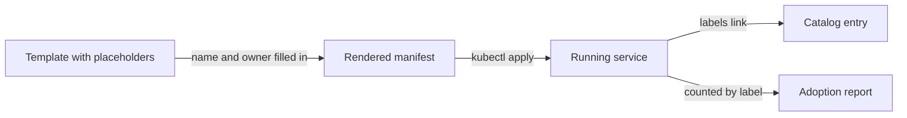

# Golden Paths And Software Templates

A new service can be started in many ways. A developer copies the manifest of a neighbour, searches the internet or writes a Deployment from memory. Each way produces a service with different labels, different limits and sometimes no health check. A **golden path** is the supported way to start and run a service, and a **software template** is the part of it that produces the first files. This part builds a template, renders a service from it and shows what the template promises.

## What a golden path is

A golden path is a route that the platform team keeps working and supports. A developer who follows it gets a service that already meets the platform rules: it has an owner, it is registered in the catalog, it has a health check and resource limits, and it deploys in the way the platform expects. The developer does not need to know all the rules, because the template carries them.

A golden path is **opinionated but not mandatory**. A team with a special need may leave it, and the platform still supports them as far as it can. Making the path attractive, with fast results and fewer decisions, is what drives adoption. Forcing it hides the cost of a bad path and produces workarounds.

## What a template carries

A template is a manifest with placeholders. When a developer fills in the name and the owner, the template becomes a complete manifest. The value of the template is in the fixed parts that the developer does not have to write:

- Labels for the catalog, such as the owner and an entity label that links the Deployment to its catalog entry.
- A readiness probe, so the platform knows when the service can take traffic.
- Resource requests and limits, so one service cannot take all memory of a node.
- A reference image or base that the platform team updates.



The diagram shows why the labels matter. The entity label connects the running service to the catalog, and the golden-path label lets the platform count how many services started from the template. A template without those labels produces services that the platform cannot see.

## A template in a ConfigMap

A portal usually stores templates in a Git repository. The playground has no Git server, so the template is stored in a ConfigMap, and the placeholders are the text `__NAME__` and `__OWNER__`. The mechanism is the same: a stored file with placeholders that a tool fills in.

Save this as `golden-path-template.yaml`:

<!-- astrona:playground:renew -->
```yaml
apiVersion: v1
kind: ConfigMap
metadata:
  name: golden-path-template
  namespace: portal
data:
  deployment.yaml: |
    apiVersion: apps/v1
    kind: Deployment
    metadata:
      name: __NAME__
      namespace: starfleet
      labels:
        app: __NAME__
        owner: __OWNER__
        catalog.starfleet.example/entity: __NAME__
        platform.starfleet.example/golden-path: "true"
    spec:
      replicas: 1
      selector:
        matchLabels:
          app: __NAME__
      template:
        metadata:
          labels:
            app: __NAME__
        spec:
          containers:
            - name: app
              image: ghcr.io/stefanprodan/podinfo:6.15.0
              ports:
                - containerPort: 9898
              readinessProbe:
                httpGet:
                  path: /healthz
                  port: 9898
              resources:
                requests:
                  cpu: 10m
                  memory: 32Mi
                limits:
                  memory: 64Mi
```

Apply it:

```sh
kubectl apply -f golden-path-template.yaml
```

The namespace `portal` must exist. It exists in the playground.

## Rendering a service

Rendering is the step where the placeholders are replaced. A portal does this when a developer fills in a form. With a command line, the replacement is a `sed` command on the template text. Read the template from the ConfigMap, replace the two placeholders and save the result:

```sh
kubectl -n portal get configmap golden-path-template -o jsonpath='{.data.deployment\.yaml}' | sed -e 's/__NAME__/beacon/g' -e 's/__OWNER__/outpost-team/g' > beacon.yaml
grep -c '__' beacon.yaml
```

The second command counts the lines that still contain a placeholder. It prints `0`, which means that every placeholder was replaced. A template can contain a placeholder that the renderer does not know. That leaves the text `__SOMETHING__` in a name or a label, and the API server rejects or stores it. Always check for leftovers before you apply.

Test the manifest against the API server without creating anything, then create the service:

```sh
kubectl apply --dry-run=server -f beacon.yaml
kubectl apply -f beacon.yaml
kubectl -n starfleet rollout status deployment/beacon --timeout=120s
```

The dry run sends the manifest through admission and validation, so schema errors and policy rejections appear before the object is stored. The Deployment `beacon` is a new Starfleet service. It was not written by hand, and it has everything the template carries.

## Check what the path produced

The labels and the probe are the proof that the template did its job. Print the labels as columns, and read the probe path:

```sh
kubectl -n starfleet get deployment beacon -L owner,catalog.starfleet.example/entity,platform.starfleet.example/golden-path
kubectl -n starfleet get deployment beacon -o jsonpath='{.spec.template.spec.containers[0].readinessProbe.httpGet.path}'
```

The first command shows the owner `outpost-team`, the entity `beacon` and the golden-path value `true`. The second prints `/healthz`. A service that has these values can be found in the catalog and counted in an adoption report.

## Keeping templates healthy

A template is software, so it needs an owner, tests and versions. Test it the way you just did: render it with sample values and send the result through a server-side dry run. A template that does not render or does not pass admission fails every developer who uses it, and the failure appears as "the platform is broken".

A template has a limit that surprises people. It produces a service once. When the platform team improves the template later, for example by adding a security setting, the services that were created earlier do not change. Plan for this. Keep the number of fixed settings small, label the services by the template version, and offer a way to update, so that old services can move to the new version when the owner chooses.

## Common pitfalls

> [!WARNING]
> A template that omits the catalog label or the owner creates services that nobody can find or contact, and the platform team often learns this months later. Always render and dry-run a template after you change it, because a broken template fails every new service at once. Services created from an old template do not update when the template changes, so track the version.
