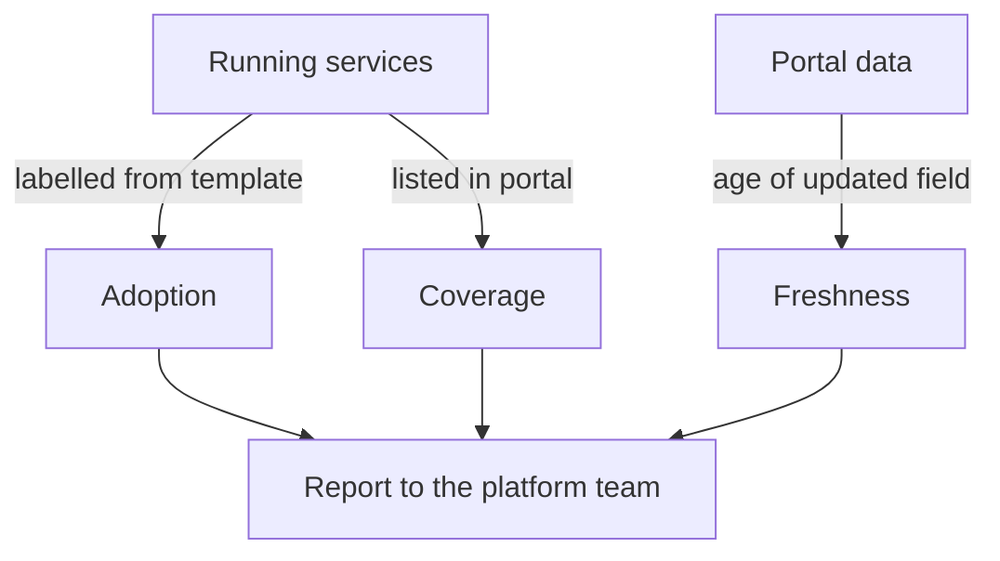

# Adoption And Freshness

A portal and a golden path are only worth the effort when developers use them. Adoption is not a launch event. It is a number that moves up or down depending on whether the portal answers questions correctly and whether the supported path is easier than the alternatives. This part defines three measures that can be computed from the cluster, shows how to read them, and explains what to do with the result.

The commands below need the portal from the first part and the service `beacon` from the second part. The playground state at this point has five Deployments in `starfleet` and `outpost`, and a portal that lists two services.

## Three measures

**Golden-path adoption** is the share of services that were created from the template. In the cluster it is the number of Deployments with the label `platform.starfleet.example/golden-path=true` divided by the number of all service Deployments. A low number means that developers do not use the template, find it too restrictive, or do not know about it.

**Portal coverage** is the share of running services that the portal lists. The portal can only help a developer find a service that it shows. A service that runs but is missing in the portal is invisible to everyone who uses the portal for discovery.

**Portal freshness** is the age of the data. The file `services.json` has a field `updated`. When the date is old, the list might be right or wrong, and the reader cannot tell. A freshness rule such as "refreshed within 30 days" makes the age something that a check can test.



The diagram shows that each measure compares two things that should match. Adoption compares services with the template, coverage compares services with the portal list, and freshness compares the date with today.

## Measuring adoption

Count the Deployments in the two service namespaces, and count how many of them carry the golden-path label. The filter selects Deployments whose namespace is `starfleet` or `outpost`, and compares the label to the text `true`:

```sh
kubectl get deployments -A -o json | jq '[.items[] | select(.metadata.namespace == "starfleet" or .metadata.namespace == "outpost")] | {total: length, goldenPath: [.[] | select(.metadata.labels["platform.starfleet.example/golden-path"] == "true")] | length}'
```

The output shows `total` as 5 and `goldenPath` as 1. Only `beacon` came from the template. The four older services were written by hand before the template existed. Four out of five is a normal first result and not a failure. It tells the platform team where to look: ask the owners of those services what prevents them from moving to the path.

## Measuring coverage

Coverage compares two lists. The first is the names of the running services. The second is the names in the portal. The difference is the set of services that the portal does not show. Save the portal names, then list the Deployments that are not in the list:

```sh
kubectl -n portal get configmap portal-catalog -o jsonpath='{.data.services\.json}' | jq '[.services[].name]' > portal-names.json
kubectl get deployments -A -o json | jq -r --slurpfile names portal-names.json '.items[] | select(.metadata.namespace == "starfleet" or .metadata.namespace == "outpost") | select(.metadata.name as $n | $names[0] | any(. == $n) | not) | .metadata.name'
```

The second command prints `shuttle`, `drifter` and `beacon`. The portal shows two of five services. Coverage is 40 percent, and a developer who searches for `beacon` finds nothing even though the service started from the supported template. That is the most damaging failure for adoption, because the supported path produces something the supported front door cannot see.

## Measuring freshness

Read the date that the portal serves, not the date in the ConfigMap, because the served copy is what a developer sees. Fetch the file from a client Pod, and compare the date with a cutoff. Dates written as `YYYY-MM-DD` compare correctly as text:

```sh
kubectl -n outpost exec deploy/drifter -- curl -s http://portal.portal.svc.cluster.local/services.json | jq -r --arg cutoff "2026-10-03" 'if .updated < $cutoff then "stale: " + .updated else "fresh: " + .updated end'
```

The portal has the date `2026-09-01` and the cutoff `2026-10-03` is 30 days before 2026-11-02, so the command prints `stale: 2026-09-01`. A stale date is a signal to refresh the data, and a refresh means to replace the content of the ConfigMap with the current service list. After the refresh, the `updated` field must change as well. Updating the list without the date hides the age, and updating the date without the list claims a refresh that did not happen.

## Acting on the numbers

A number is only useful when someone acts on it. Low coverage is a data problem and has a technical answer: feed the portal from the catalog automatically, so that a new service appears without a person editing a file. Low adoption is a product problem and needs a conversation. Ask why teams stay off the path, and look at the answers. Common reasons are that the template does not fit a type of service, that it is slower than copying a neighbour, that it is not documented, or that nobody told the team about it.

Supported adoption means that the platform team helps teams move: it fixes the template when it blocks a team, it writes migration steps for existing services, and it keeps the alternative interfaces working for teams that need them. A mandate without support produces copies of the template with the checks removed, and the numbers then look good while the behavior does not change.

## What the numbers do not show

Each measure hides something. Adoption counts labels, and a label can be copied onto a service that does not follow the template. A service can have the golden-path label and still lack the probe if somebody edited it later. Treat the label as an indication, and use a policy or a periodic check on the settings themselves when the setting matters.

Coverage counts names, and it does not show whether the entry is correct. A service can appear in the portal with the wrong owner. Add a check on the content, such as "no entry has an empty owner", next to the check on the count.

Freshness shows the age of the data and not its correctness. A refresh that copies old data produces a new date and the same errors. The strongest fix is to remove the copy: let the portal read the catalog directly, and the question of freshness becomes the question of the catalog's freshness, which has an owner and a query.

## Alternative interfaces

A portal is one interface, and engineers use others: a command line tool, a Git repository with manifests, or direct API calls. Keep them working and documented. Teams that automate their delivery need an API, and an on-call engineer during an incident needs a path that does not depend on a web page. When these paths exist, a low portal number is not an emergency, because the platform is still used. Count the use of the platform through all interfaces, and the portal number is one part of the picture.

## Publishing the numbers

Write the numbers where the team can see them, for example in a ConfigMap that a dashboard or the portal reads. Keep them computed, not typed: a report that a person types in can differ from the cluster on the day it is written.

```sh
kubectl -n portal create configmap adoption-report --from-literal=total=5 --from-literal=goldenPath=1
```

The values come from the measure above, so state them only after you have computed them. When more services start from the template, run the measure again and replace the report.

## Common pitfalls

> [!WARNING]
> Adoption numbers that are typed in by hand drift from the cluster, so compute them from labels each time. Do not force teams onto the path without support, because the common reaction is a copy of the template without its checks. A refreshed list with an old `updated` date, or the reverse, makes the freshness measure useless, so change both together.
