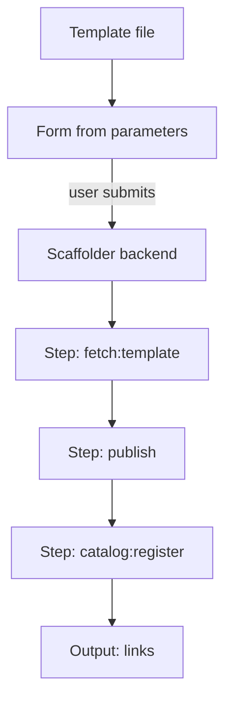

# The Anatomy Of A Template

A new service needs a repository, a build, a health check, an owner and a catalog entry. A developer who does this by hand forgets something every time. A template carries those rules once, so every new service starts correct. This part explains the structure of the template file before the next parts fill in each section.

## The envelope

A template file has the same envelope as every catalog entity. The field `apiVersion` is `scaffolder.backstage.io/v1beta3`, the field `kind` is `Template`, and `metadata` has a `name`, a `title` and a `description` that the portal shows on the template card. The `spec` has the fields below.

- `owner` names the team that maintains the template.
- `type` groups templates in the portal, for example `service` or `website`.
- `parameters` describes the input form.
- `steps` lists the actions that run after the user submits the form.
- `output` lists the links and the text that the portal shows when the run is finished.

## A first look

The playground stores a template in a ConfigMap. Print it:

<!-- astrona:playground:renew -->
```sh
kubectl get configmap scaffolder-templates -n portal -o jsonpath='{.data.template\.yaml}'
```

The template has a `parameters` list with the field `name`, one step with the action `fetch:template`, and no `output` yet. The next parts add what is missing.

## How a run works

When a user opens a template, the portal builds a form from `parameters`. The user fills in the form and submits it. The Scaffolder backend then runs the steps in order. Each step calls an **action**, which is a function that the backend provides, such as `fetch:template` or `publish:github`. A step receives `input` values, and it can produce an output that later steps read.



The diagram shows the order. The form comes first, the steps follow and the output closes the run.

## The skeleton

The action `fetch:template` copies a folder of files, called the **skeleton**, into the working directory of the run and replaces placeholders with the values of the form. The skeleton is where the platform rules live: the Dockerfile, the pipeline file, the health check and the `catalog-info.yaml` of the new service. The placeholders use the syntax `${{ values.name }}`. The template engine is Nunjucks.

A skeleton file for the descriptor of the new service can look like this:

```yaml
apiVersion: backstage.io/v1alpha1
kind: Component
metadata:
  name: ${{ values.name }}
  annotations:
    backstage.io/kubernetes-id: ${{ values.name }}
spec:
  type: service
  lifecycle: experimental
  owner: ${{ values.owner }}
```

Every service made from the template gets an owner, the annotation that links it to Kubernetes, and a lifecycle. The developer does not type any of these rules.

## Common pitfalls

> [!WARNING]
> - The `${{ parameters.name }}` form is used inside the template file. The `${{ values.name }}` form is used inside the skeleton files. Mixing them leaves the text unchanged.
> - A template without an owner has nobody to fix it when a step breaks.
> - Do not put credentials in the skeleton. Use the integrations of the portal for tokens.
