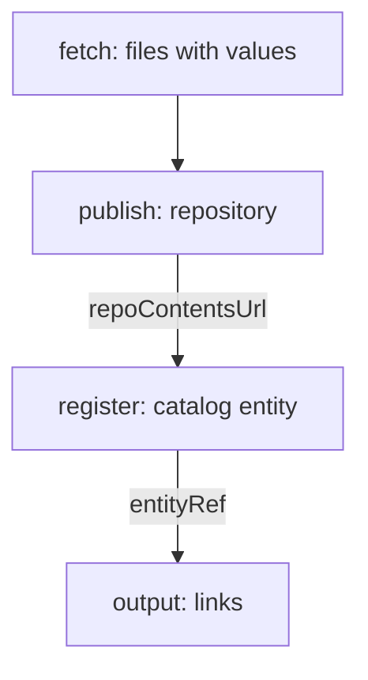

# Steps, Actions And Outputs

The steps do the work. They create the files, the repository and the catalog entry. This part shows the three actions that almost every service template uses, how steps pass values to each other, and what the output shows to the user.

## Actions

Each step has an `id`, a `name`, an `action` and an `input`. The backend runs the steps in order and stops at the first failure. The actions below are part of the default Backstage installation.

- `fetch:template` copies the skeleton and replaces placeholders.
- `fetch:plain` copies files without replacing anything.
- `publish:github` and similar actions for other code hosts create a repository and push the files.
- `catalog:register` registers the new `catalog-info.yaml` in the catalog.
- `debug:log` prints a value, which is useful while you write a template.

Platform teams can add their own actions in a backend plugin, for example an action that creates a database or a namespace.

## A complete steps section

A complete steps section looks like this:

```yaml
steps:
  - id: fetch
    name: Fetch skeleton
    action: fetch:template
    input:
      url: ./skeleton
      values:
        name: ${{ parameters.name }}
        owner: ${{ parameters.owner }}
  - id: publish
    name: Publish repository
    action: publish:github
    input:
      repoUrl: github.com?owner=starfleet&repo=${{ parameters.name }}
      description: ${{ parameters.name }} service
  - id: register
    name: Register in the catalog
    action: catalog:register
    input:
      repoContentsUrl: ${{ steps['publish'].output.repoContentsUrl }}
      catalogInfoPath: /catalog-info.yaml
output:
  links:
    - title: Repository
      url: ${{ steps['publish'].output.remoteUrl }}
    - title: Open in catalog
      icon: catalog
      entityRef: ${{ steps['register'].output.entityRef }}
```

The first step uses the values of the form. The second step publishes the files. The third step reads the address that the second step produced, with the expression `steps['publish'].output.repoContentsUrl`, and registers the descriptor. The `output` section gives the user two links when the run is done.

## Order matters

A step can use only the output of steps before it. The registration step must come after the publish step, because it needs the address of the new repository. A missing `catalog:register` step is a common reason why a new service never appears in the catalog. The repository exists, and the portal does not know about it.



The diagram shows which step passes which value to the next one.

## Conditions

A step can have an `if` field with an expression, for example `if: ${{ parameters.tier === 'critical' }}`. The backend runs the step only when the expression is true. Use this for an optional part, such as an extra alert rule for critical services.

## Checking the stored template

The template in the playground has the step `fetch` only. Check which actions it uses:

<!-- astrona:playground:renew -->
```sh
kubectl get configmap scaffolder-templates -n portal -o jsonpath='{.data.template\.yaml}' | grep -n 'action:'
```

The command prints one line for each step. A template that creates a repository and has no `catalog:register` line produces services that nobody can find in the catalog.

## Common pitfalls

> [!WARNING]
> - A step that fails after `publish` leaves a repository behind. Keep steps small, and design a way to clean up.
> - Output expressions use `steps['id']` with the exact `id` of the step. A wrong id gives an empty value.
> - A skeleton file that contains the text `${{` for another tool must be escaped, or the template engine replaces it.
