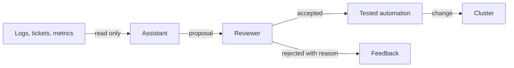

# Where AI Fits In Platform Automation

Platform teams automate to remove repeated manual work. A script restarts a failed job, a controller reconciles a request, a pipeline runs a test. An AI assistant adds a different kind of automation: it works on text and on situations that no script anticipated. This part describes what the assistant is good at, what makes it different from a script, and why its credentials decide how much damage a wrong answer can do. It ends with an assistant that has far too much authority, so you can see the problem before you fix it.

## Tasks that suit an assistant

An assistant is useful where the input is messy and a wrong answer is cheap to catch. Typical tasks are:

- **Summarizing** a long incident timeline or a noisy log into a few sentences.
- **Classifying** a support request by team, urgency or type.
- **Explaining** an error message in plain words and pointing to the likely cause.
- **Drafting** a change, such as a resource limit that fits observed use, for a person to review.
- **Searching** documentation and the catalog to answer a question such as who owns a service.

All of these produce text or a proposal. A person can read the result in seconds and decide whether it is right.

## Tasks that need deterministic automation

A script with fixed rules always gives the same result for the same input, and it can be tested. Some tasks need this property: rotating a certificate, applying a policy, scaling on a defined metric, deleting expired environments. An assistant can give a different answer on a second run, and it can state a wrong answer with confidence. A task whose failure is expensive or hard to undo belongs to deterministic automation, or to a change that a person approves.

The practical rule is to let the assistant **decide what to propose** and let tested automation and people **decide what to do**.



The diagram shows that the assistant has no arrow to the cluster. Everything it produces passes a reviewer first, and only tested automation changes the cluster.

## What makes an assistant different

Three properties change how you design around an assistant. First, its output is **not deterministic**. The same question can give different answers, so a test of one run proves little. Second, it can be **wrong with confidence**: the answer reads well even when it is false, so a reviewer cannot judge by tone. Third, it is **steered by its input**. Anything the assistant reads, such as a log line, a ticket or a document, can contain text that looks like an instruction. If the assistant follows it, the author of that text has influenced what the assistant does.

The third property is the reason that authority must not depend on what the assistant reads. You cannot reliably stop an assistant from following a bad instruction in its input. You can make sure that following it cannot do harm, because the identity has no permission to cause it.

## The assistant's authority is its credentials

An assistant that works in a cluster does so through a Kubernetes identity, normally a ServiceAccount. The API server does not know that the caller is an assistant. It checks the permissions of the identity, and it allows what the permissions allow. If the identity may delete Deployments, then a wrong answer, a mistake or a manipulated input can delete Deployments.

Many teams start by giving the assistant a broad built-in role, because it works at once. The ClusterRole `edit` allows creating, changing and deleting most objects in a namespace. That is the starting point of this part.

## An over-privileged assistant

Save this as `assistant-start.yaml`. It creates the ServiceAccount `ops-assistant` and binds the `edit` role to it in the namespace `starfleet`:

<!-- astrona:playground:renew -->
```yaml
apiVersion: v1
kind: ServiceAccount
metadata:
  name: ops-assistant
  namespace: assistant
---
apiVersion: rbac.authorization.k8s.io/v1
kind: RoleBinding
metadata:
  name: ops-assistant-edit
  namespace: starfleet
subjects:
  - kind: ServiceAccount
    name: ops-assistant
    namespace: assistant
roleRef:
  kind: ClusterRole
  name: edit
  apiGroup: rbac.authorization.k8s.io
```

```sh
kubectl apply -f assistant-start.yaml
```

The identity of a ServiceAccount in an authorization check is `system:serviceaccount:<namespace>:<name>`. The command `kubectl auth can-i` can ask the API server for another identity with `--as`, so you can test what the assistant may do without running one:

```sh
kubectl auth can-i delete deployments -n starfleet --as=system:serviceaccount:assistant:ops-assistant
kubectl auth can-i create pods -n starfleet --as=system:serviceaccount:assistant:ops-assistant
kubectl auth can-i delete deployments -n outpost --as=system:serviceaccount:assistant:ops-assistant
```

The first two commands print `yes`. The third prints `no`, because the binding exists only in `starfleet`. An assistant that suggests restarting `probe` can also delete `scout`, if a mistake or a manipulated input leads it there. The authority is larger than the task.

## What to learn from this

The test you just ran is the most useful habit of this module: ask the API server what an identity may do before you trust it. Run it for the dangerous verbs (`delete`, `patch`, `create` on workloads) and for sensitive objects such as Secrets. A permission list that you cannot recite is a permission list that is too wide.

```sh
kubectl auth can-i get secrets -n starfleet --as=system:serviceaccount:assistant:ops-assistant
```

This prints `yes` as well, because `edit` allows reading Secrets in the namespace. An assistant that can read Secrets can also place their content into a proposal or a summary. The next part replaces this binding with exactly the permissions the assistant needs.

## Common pitfalls

> [!WARNING]
> Do not give an assistant a broad built-in role such as `edit` or `cluster-admin` because it makes the first demo work. Its credentials are its authority, and a wrong or manipulated answer can use all of it. Test the permissions of the identity with `kubectl auth can-i --as=...` before you connect an assistant, and keep Secrets out of reach.
