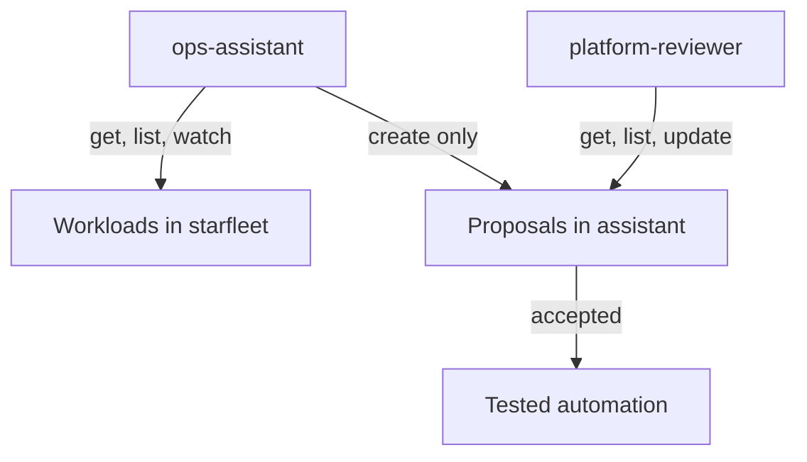

# Bounded Authority

The previous part ended with an assistant that could delete Deployments and read Secrets. This part replaces that with bounded authority: the assistant can read what it needs to understand a situation, and it can write one thing, a proposal. It cannot change the cluster, and it cannot approve its own proposal. Two mechanisms enforce this, RBAC for what the assistant may call and an admission policy for what it may write.

The commands below need the ServiceAccount `ops-assistant` and the binding `ops-assistant-edit` from the previous part.

## Three roles, three jobs

The design has three identities with different jobs. The **assistant** (`ops-assistant`) reads the state of the Starfleet workloads and writes proposals. The **reviewer** (`platform-reviewer`) reads the proposals and records a decision. The **automation** that applies accepted changes is not part of this module: it would be a tested pipeline with its own identity.



The assistant has two arrows and no arrow back to the cluster. A proposal is an object, a ConfigMap in the namespace `assistant`, with a label `proposal-status` that says where it is in the review. The assistant creates it with the value `proposed`, and only the reviewer changes the value to `accepted` or `rejected`.

## RBAC for each identity

A Role lists verbs on resources in one namespace, and a RoleBinding gives the Role to an identity. Three Roles are needed. The reading Role allows `get`, `list` and `watch` on Deployments, ReplicaSets and Pods in `starfleet`, and on pod logs. It does not mention Secrets, so Secrets are out of reach. The writing Role allows only `create` on ConfigMaps in `assistant`. The reviewing Role allows reading and updating ConfigMaps in `assistant`.

Save this as `assistant-roles.yaml`:

<!-- astrona:playground:renew -->
```yaml
apiVersion: rbac.authorization.k8s.io/v1
kind: Role
metadata:
  name: ops-reader
  namespace: starfleet
rules:
  - apiGroups: ["apps"]
    resources: ["deployments", "replicasets"]
    verbs: ["get", "list", "watch"]
  - apiGroups: [""]
    resources: ["pods", "pods/log"]
    verbs: ["get", "list", "watch"]
---
apiVersion: rbac.authorization.k8s.io/v1
kind: RoleBinding
metadata:
  name: ops-assistant-reader
  namespace: starfleet
subjects:
  - kind: ServiceAccount
    name: ops-assistant
    namespace: assistant
roleRef:
  kind: Role
  name: ops-reader
  apiGroup: rbac.authorization.k8s.io
---
apiVersion: rbac.authorization.k8s.io/v1
kind: Role
metadata:
  name: proposal-writer
  namespace: assistant
rules:
  - apiGroups: [""]
    resources: ["configmaps"]
    verbs: ["create"]
---
apiVersion: rbac.authorization.k8s.io/v1
kind: RoleBinding
metadata:
  name: ops-assistant-writer
  namespace: assistant
subjects:
  - kind: ServiceAccount
    name: ops-assistant
    namespace: assistant
roleRef:
  kind: Role
  name: proposal-writer
  apiGroup: rbac.authorization.k8s.io
---
apiVersion: rbac.authorization.k8s.io/v1
kind: Role
metadata:
  name: proposal-reviewer
  namespace: assistant
rules:
  - apiGroups: [""]
    resources: ["configmaps"]
    verbs: ["get", "list", "watch", "update", "patch"]
---
apiVersion: rbac.authorization.k8s.io/v1
kind: RoleBinding
metadata:
  name: platform-reviewer-binding
  namespace: assistant
subjects:
  - kind: User
    name: platform-reviewer
    apiGroup: rbac.authorization.k8s.io
roleRef:
  kind: Role
  name: proposal-reviewer
  apiGroup: rbac.authorization.k8s.io
```

Apply the new Roles and remove the broad binding. RBAC is additive, so the new bindings do not take away the old permissions. Only deleting the old binding does that:

```sh
kubectl apply -f assistant-roles.yaml
kubectl -n starfleet delete rolebinding ops-assistant-edit
```

Test the result for the assistant. The reading verbs are allowed and the others are not:

```sh
kubectl auth can-i list deployments -n starfleet --as=system:serviceaccount:assistant:ops-assistant
kubectl auth can-i delete deployments -n starfleet --as=system:serviceaccount:assistant:ops-assistant
kubectl auth can-i get secrets -n starfleet --as=system:serviceaccount:assistant:ops-assistant
```

The first command prints `yes`, and the second and third print `no`. The assistant can now see the workloads and cannot change them or read Secrets.

## Why RBAC alone is not enough

RBAC controls which verbs the assistant may use, but it cannot control the content that the assistant writes. The assistant may create ConfigMaps in `assistant`, so it may also create a ConfigMap whose label says `proposal-status: accepted`. A reviewer who filters on accepted proposals, or automation that applies them, would then act on a proposal that nobody reviewed. The assistant would have approved its own work.

An admission policy closes the gap. A **ValidatingAdmissionPolicy** evaluates a CEL expression on each write, and the expression can read the identity of the caller in `request.userInfo`. The rule below says: if the caller is `ops-assistant`, the label `proposal-status` must be `proposed`. For every other caller the rule passes, so the reviewer can set the decision.

Save this as `assistant-policy.yaml`:

```yaml
apiVersion: admissionregistration.k8s.io/v1
kind: ValidatingAdmissionPolicy
metadata:
  name: assistant-proposals-start-proposed
spec:
  failurePolicy: Fail
  matchConstraints:
    resourceRules:
      - apiGroups: [""]
        apiVersions: ["v1"]
        operations: ["CREATE", "UPDATE"]
        resources: ["configmaps"]
  validations:
    - expression: "request.userInfo.username != 'system:serviceaccount:assistant:ops-assistant' || (has(object.metadata.labels) && 'proposal-status' in object.metadata.labels && object.metadata.labels['proposal-status'] == 'proposed')"
      message: "proposals from ops-assistant must carry the label proposal-status=proposed"
---
apiVersion: admissionregistration.k8s.io/v1
kind: ValidatingAdmissionPolicyBinding
metadata:
  name: assistant-proposals-start-proposed
spec:
  policyName: assistant-proposals-start-proposed
  validationActions:
    - Deny
  matchResources:
    namespaceSelector:
      matchLabels:
        kubernetes.io/metadata.name: assistant
```

The binding applies the policy to the namespace `assistant` and denies on failure. The policy takes a few seconds to become active after you apply it.

## Proposing and reviewing

Save a proposal that claims to be accepted as `proposal.yaml`. It names a target, an action and a reason, which is what a reviewer needs to decide:

```yaml
apiVersion: v1
kind: ConfigMap
metadata:
  name: proposal-restart-probe
  namespace: assistant
  labels:
    proposal-status: approved
data:
  target: deployment/probe
  action: restart
  reason: The probe pod has restarted three times in an hour with exit code 137.
```

Apply the policy, then send the proposal as the assistant through a server-side dry run. Dry runs go through admission and authorization, so nothing is stored:

```sh
kubectl apply -f assistant-policy.yaml
kubectl --as=system:serviceaccount:assistant:ops-assistant create --dry-run=server -f proposal.yaml
```

The second command fails with the message `proposals from ops-assistant must carry the label proposal-status=proposed`. If it succeeds, the policy is not active yet, so wait a few seconds and run it again. Now correct the label and create the proposal for real, as the assistant, and let the reviewer accept it:

```sh
sed 's/approved/proposed/' proposal.yaml | kubectl --as=system:serviceaccount:assistant:ops-assistant create -f -
kubectl -n assistant label configmap proposal-restart-probe proposal-status=accepted --overwrite --as=platform-reviewer
```

The assistant creates the proposal with the status `proposed`. The reviewer changes it to `accepted`, which the policy allows because the caller is not the assistant. The assistant itself cannot update its proposal, because its Role has no `update` verb.

## Common pitfalls

> [!WARNING]
> RBAC is additive, so adding a narrow Role does not remove a broad binding: delete the old binding and test again with `kubectl auth can-i --as=...`. Do not rely on an instruction in a prompt to keep an assistant inside its limits, because credentials and admission policy hold and instructions do not. A new admission policy needs a few seconds before it denies, so retry a test that unexpectedly succeeds.
