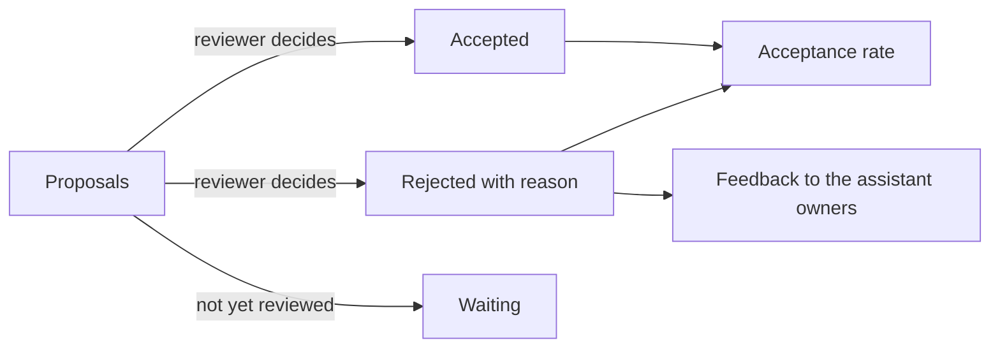

# Evaluation And Feedback

An assistant that proposes changes is only useful if its proposals are mostly good, and the team can only know that by measuring. Bounded authority limits the damage of a bad proposal. Evaluation tells you how often proposals are bad, why, and whether the assistant has earned more trust or less. This part records review outcomes on the proposals, computes an acceptance rate, reads the reasons for rejection and turns the result into a decision about the assistant's mode.

The commands below need the namespace `assistant` and the ServiceAccount `ops-assistant`. They do not depend on earlier proposals, because they select a batch by label.

## What to record

A reviewed proposal has three facts worth keeping: the **outcome** (accepted or rejected), the **reason** for a rejection, and the **batch** it belongs to, so that numbers from one week can be compared with another. The playground uses labels for the first and the third, and an annotation for the reason. A label can be selected with `kubectl -l`, which is why the outcome is a label. A reason is free text, so it is an annotation.

A proposal that has not been reviewed yet has the status `proposed`. It is neither good nor bad, so it stays out of the acceptance rate. Counting it as accepted would make the rate look better than it is, and counting it as rejected would make it look worse.

## Seed a batch of reviewed proposals

Save this as `proposals-week-1.yaml`. It holds six proposals from one week: three accepted, two rejected with reasons and one still waiting:

<!-- astrona:playground:renew -->
```yaml
apiVersion: v1
kind: ConfigMap
metadata:
  name: week1-01
  namespace: assistant
  labels: {batch: week-1, proposal-status: accepted}
data: {target: deployment/probe, action: restart, reason: Repeated restarts with exit code 137}
---
apiVersion: v1
kind: ConfigMap
metadata:
  name: week1-02
  namespace: assistant
  labels: {batch: week-1, proposal-status: accepted}
data: {target: deployment/scout, action: raise-memory-limit, reason: Memory use is above 90 percent of the limit}
---
apiVersion: v1
kind: ConfigMap
metadata:
  name: week1-03
  namespace: assistant
  labels: {batch: week-1, proposal-status: accepted}
data: {target: deployment/shuttle, action: add-owner-label, reason: The Deployment has no owner label}
---
apiVersion: v1
kind: ConfigMap
metadata:
  name: week1-04
  namespace: assistant
  labels: {batch: week-1, proposal-status: rejected}
  annotations: {review-reason: wrong-target}
data: {target: deployment/drifter, action: restart, reason: The log shows an error}
---
apiVersion: v1
kind: ConfigMap
metadata:
  name: week1-05
  namespace: assistant
  labels: {batch: week-1, proposal-status: rejected}
  annotations: {review-reason: unsafe}
data: {target: deployment/scout, action: scale-to-zero, reason: Reduce cost}
---
apiVersion: v1
kind: ConfigMap
metadata:
  name: week1-06
  namespace: assistant
  labels: {batch: week-1, proposal-status: proposed}
data: {target: deployment/probe, action: raise-cpu-request, reason: Throttling above 40 percent}
```

```sh
kubectl apply -f proposals-week-1.yaml
```

In a real system the assistant creates these, and the policy from the previous part forces the status `proposed`. Here you create them as the administrator, so that the batch already contains reviewed outcomes.

## Count the outcomes

Read the batch as JSON, and let `jq` group the proposals by the label `proposal-status`. The filter `group_by` sorts the list into groups with the same value, and the `map` step turns each group into a status and a count:

```sh
kubectl -n assistant get configmaps -l batch=week-1 -o json | jq -c '.items | group_by(.metadata.labels["proposal-status"]) | map({status: .[0].metadata.labels["proposal-status"], count: length})'
```

The output shows three accepted, two rejected and one proposed. The acceptance rate is the number accepted divided by the number reviewed, which is accepted plus rejected:

```text
acceptanceRate = accepted / (accepted + rejected) * 100
```

With three accepted and two rejected the rate is 3 divided by 5, which is 60 percent. The pending proposal is not in the formula.



The diagram shows the two uses of a rejection. It lowers the acceptance rate, and its reason is the feedback that tells the owners what to improve.

## Read the reasons

The rate tells you how often the assistant is wrong. The reasons tell you how. Count the rejections by reason:

```sh
kubectl -n assistant get configmaps -l batch=week-1,proposal-status=rejected -o json | jq -c '[.items[].metadata.annotations["review-reason"]] | group_by(.) | map({reason: .[0], count: length})'
```

The output shows one `wrong-target` and one `unsafe`. These are different problems. A `wrong-target` rejection means the assistant misread the situation, and better context could help, such as the catalog entry of the service. An `unsafe` rejection means the assistant proposed an action that no reviewer should ever accept, such as scaling a production service to zero. That is a reason to make the action impossible, for example by removing it from the actions the proposal format allows.

## Small numbers and review habits

Five reviewed proposals are too few to conclude anything. A rate of 60 percent over five proposals could be 80 percent over fifty. Set a minimum number of reviewed proposals before a decision, and compare batches over several weeks.

A reviewer who accepts every proposal quickly makes the rate meaningless. A rate near 100 percent may mean a good assistant or a tired reviewer. Check a sample: take a few accepted proposals and review them again as if they were new. Record how long reviews take, because a review that takes seconds on a complex change is a warning sign.

## Decide the mode and record it

The result feeds a decision about the assistant's **mode**. In `suggest-only` mode every proposal goes to a reviewer. A later mode could let the assistant apply a narrow class of low-risk actions without review, but only when the evidence supports it. A reasonable rule is: the mode stays `suggest-only` until at least twenty proposals were reviewed and the acceptance rate is 90 percent or higher, and the mode returns to `suggest-only` when the rate falls.

This batch has five reviewed proposals and a rate of 60 percent, so the mode stays `suggest-only`. Record the numbers and the decision in an object that dashboards and the next review can read:

```sh
kubectl -n assistant create configmap assistant-evaluation --from-literal=reviewed=5 --from-literal=accepted=3 --from-literal=rejected=2 --from-literal=acceptanceRate=60 --from-literal=mode=suggest-only
```

Keep the values computed from the batch. A number typed from memory is a number that nobody can reproduce, and the next reviewer will not know which batch it describes.

## Common pitfalls

> [!WARNING]
> Do not count proposals that wait for review as accepted or rejected, because that moves the acceptance rate in either direction. A rate from a handful of proposals is noise, so set a minimum count before widening anything. A reviewer who accepts everything makes the measure useless, so sample accepted proposals and review them again.
