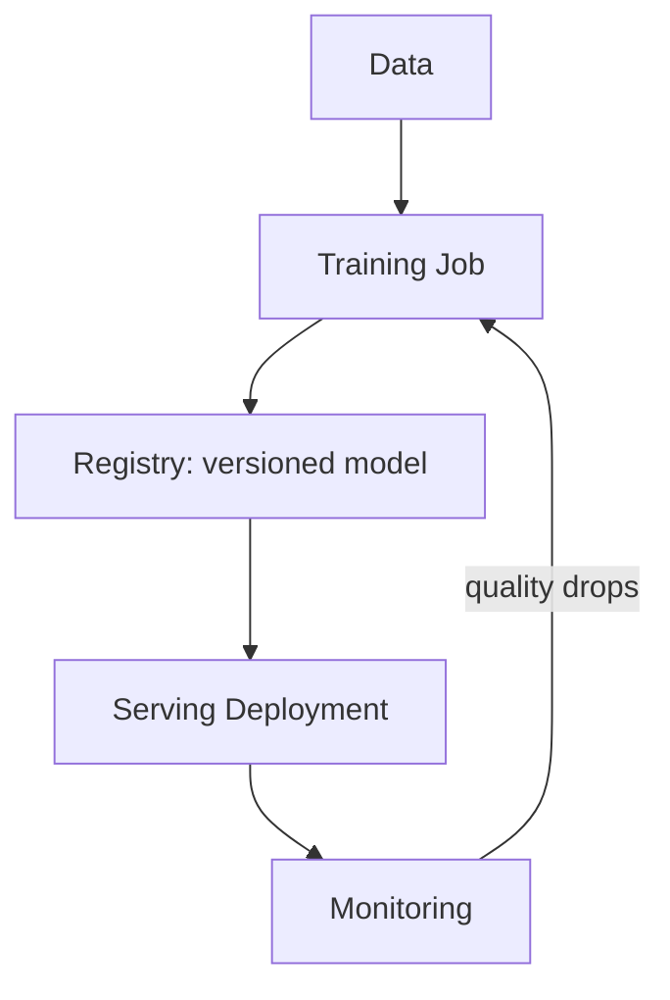

# The ML Lifecycle And What The Platform Provides

A data scientist wants to train a model and put it in front of users. The work is more than code: it needs data, compute, storage, tracking and a way to serve the result. A platform team that knows the stages can offer a supported capability for each one, instead of a one-off setup for every team. This part lists the stages and what Kubernetes and the tools around it provide.

## The stages

The **ML lifecycle** is the loop that a model goes through from data to production. It has five stages.

- **Data preparation** collects and cleans the data and stores it where training can read it, for example an object store.
- **Training** runs code on the data to produce a model file. It often needs GPUs and may run for hours.
- **Tracking and registry** records the parameters, the metrics and the model files of each run, and stores approved models with a version.
- **Serving** runs the model behind an API so that other services can call it.
- **Monitoring** watches the quality of the predictions and the health of the server, and starts the loop again when quality drops.

## The platform capability for each stage

Kubernetes does not have an ML feature. It has building blocks that the tools in this space use.

| Stage | Kubernetes building block | Common tool |
| --- | --- | --- |
| Data | PersistentVolumeClaim, Secret for storage credentials | Object stores, data pipelines |
| Training | Job, CronJob, extended resources | Kubeflow Training Operator, Argo Workflows |
| Tracking and registry | Deployment, Service, database | MLflow |
| Serving | Deployment, Service, HorizontalPodAutoscaler | KServe |
| Monitoring | Metrics, alert rules | Prometheus |

A tool such as Kubeflow or KServe adds custom resources and controllers on top of these blocks, in the same way as the request API you can build with a CustomResourceDefinition. The platform team installs the tool once and offers the custom resource as the supported interface.



The diagram shows that the lifecycle is a loop. Monitoring can start a new training run.

## What the platform team decides

The platform team does not decide how a model is built. It decides the supported ways to run the stages: which namespaces teams use, how many GPUs each team may hold, how long finished jobs stay, which image registry is allowed and how a model reaches production. Those decisions turn into objects that you can create with `kubectl`.

You can start with the objects of the playground. Look at the namespace of the ML team and its Job:

<!-- astrona:playground:renew -->
```sh
kubectl get namespace ml-team
kubectl get job retrain -n ml-team
```

The Job `retrain` exists but is suspended, so it does not start any Pod.

## Common pitfalls

> [!WARNING]
> - Treating ML like a normal web service. Training is a batch workload, and it should not run as a Deployment.
> - Giving every team its own tool set. Each stack needs upgrades and security fixes.
> - Forgetting the loop. A model in production that nobody monitors becomes wrong over time.
