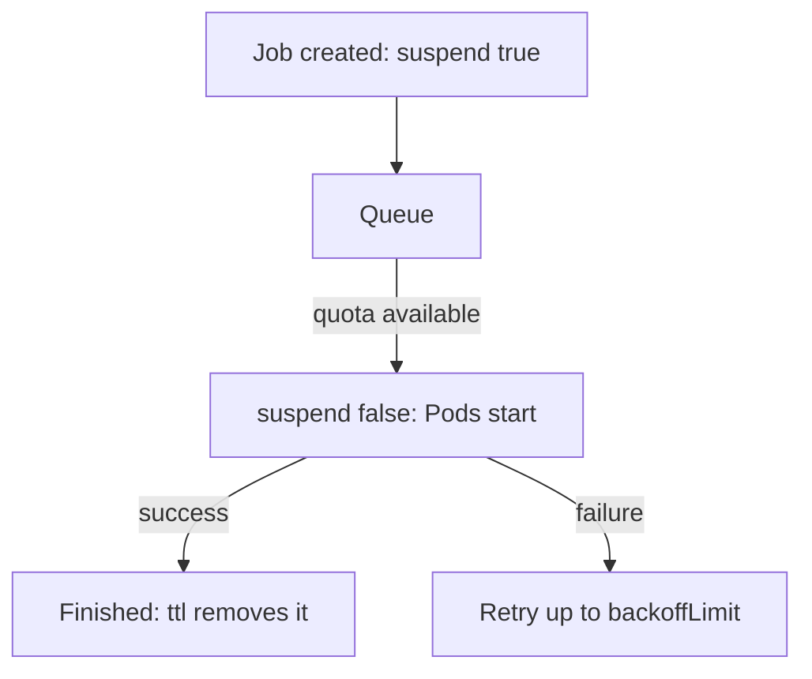

# Training Jobs, Queues And Priorities

Training code runs to completion, then stops. Kubernetes has an object for that: the Job. This part shows the settings of a training Job, how priorities decide which work gets scarce resources first, and how a queue prevents a pile of Pending Pods.

## A training Job

A **Job** creates Pods and retries them until a number of them finish successfully. Unlike a Deployment, a Job is not restarted when it succeeds. The settings that matter for training are these.

- `backoffLimit` is the number of retries after a failure. The default is 6, and a job that fails on a bug should not retry for hours.
- `ttlSecondsAfterFinished` removes the Job and its Pods after the given time. Without it, finished Pods stay and keep their logs, but they also fill the namespace.
- `suspend` creates the Job without starting any Pod. Setting it back to `false` starts the Job. A queueing system uses this field to decide when a Job may start.
- `completions` and `parallelism` run several Pods, for example one per data shard.

The Job `retrain` in the playground is suspended and has no clean-up time. Read its settings:

<!-- astrona:playground:renew -->
```sh
kubectl get job retrain -n ml-team -o jsonpath='{.spec.suspend} {.spec.backoffLimit} {.spec.ttlSecondsAfterFinished}'
```

The output shows `true`, `2` and an empty third value. Add a clean-up time with a patch. The field `ttlSecondsAfterFinished` can be changed on an existing Job:

```sh
kubectl patch job retrain -n ml-team --type merge -p '{"spec":{"ttlSecondsAfterFinished":3600}}'
```

Read the settings again to see the new value.

## Priorities and preemption

A **PriorityClass** gives Pods a number. When the cluster has no room, the scheduler places Pods with a higher number first. If a Pod with a high priority cannot be placed, the scheduler can **preempt** it: it evicts Pods with a lower priority to make room. The field `preemptionPolicy: Never` stops a class from preempting others. Its Pods still queue before lower-priority Pods but they never evict a running Pod.

Save this as `priorityclass-training-low.yaml`:

```yaml
apiVersion: scheduling.k8s.io/v1
kind: PriorityClass
metadata:
  name: training-low
value: 1000
preemptionPolicy: Never
description: Batch training that waits for free capacity and never evicts others
```

Apply it:

```sh
kubectl apply -f priorityclass-training-low.yaml
```

A Pod or Job template uses the class with `priorityClassName: training-low`. A platform usually offers two or three classes, for example one for serving, one for training and one for experiments, so that the production model server is never evicted for an experiment.

## Queueing

Quota and priority are not enough when many teams submit Jobs at the same time. Each Job creates Pods that wait as `Pending` and each one holds a place in the scheduler queue. A job queueing system such as Kueue admits a Job only when the resources it needs are free. It uses the `suspend` field: Jobs wait in a suspended state and the system sets `suspend: false` when it is their turn. Teams then share capacity by agreed rules, not by who submits first.



The diagram shows the path of a Job through a queue. The Job runs only when capacity is free and is removed after it finishes.

## Common pitfalls

> [!WARNING]
> - `backoffLimit` and the Pod template of a Job cannot be changed after creation. Set them before the Job is created.
> - A high priority without a quota lets one team evict everyone else. Pair priority with quota.
> - Without `ttlSecondsAfterFinished`, finished Jobs accumulate and slow down listings.
